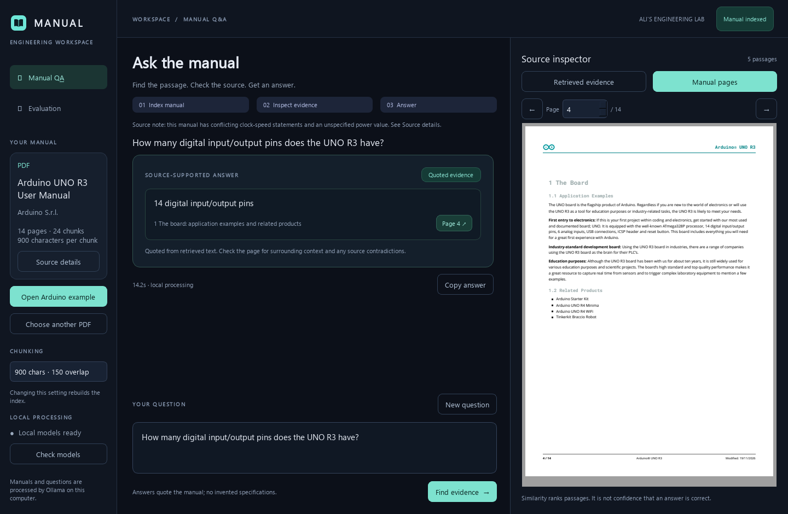
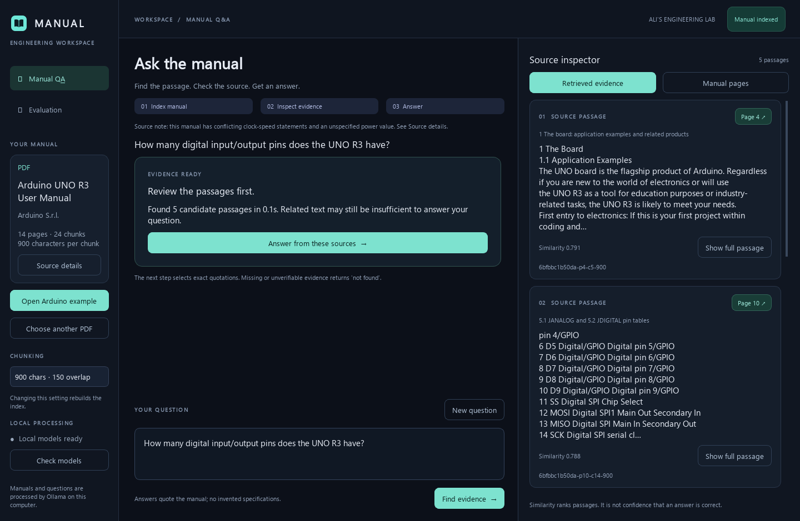
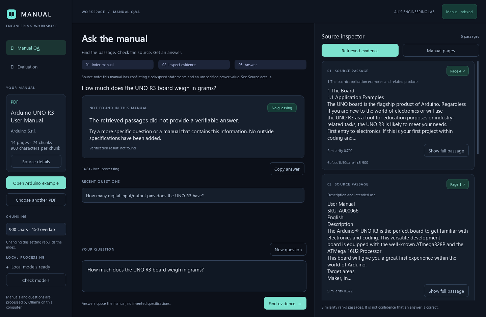
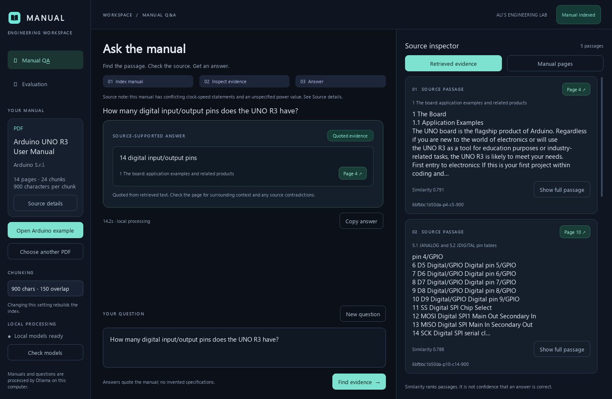
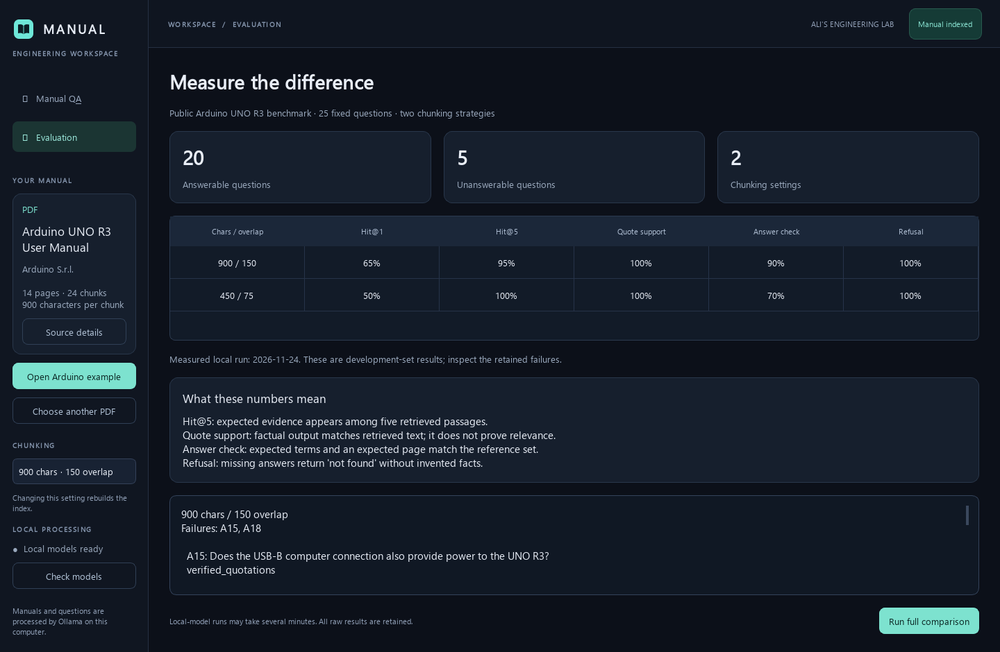

# Engineering Manual Q&A

A local Windows application for asking questions about engineering manuals, inspecting retrieved evidence before answering, and opening cited PDF pages. Built by extending Ali's existing RAG Study Assistant for Module 5, Build 5A.

The language model proposes a short source quotation. The application finds the matching text in the actual retrieved passages, derives the citation itself, and copies the factual answer from that source. An invalid quotation returns "not found." This checks source containment, not whether the manual is correct or the chosen passage answers the question.



On Ali's computer, use the prepared source launcher. Windows Application Control blocked the unsigned packaged executable, so that executable has not passed a launch or packaged-backend check. The source application passed the actual interface and local-model checks. See docs/verification/release-status.json.

## Screenshots

| Inspect evidence before answering | Refuse missing information |
| --- | --- |
|  |  |

| Answer with page citations | Compare measured retrieval results |
| --- | --- |
|  |  |

[View the compact desktop layout](docs/screenshots/compact-layout.png).

Published to GitHub and checked from a fresh clone on 2026-11-25: all 47 tests passed, the source UI started, the official manual downloaded with its expected hash, and all six screenshots and local README links were verified. See [the clean-clone record](docs/verification/clean-clone-check.json).

## Problem and purpose

Engineering manuals mix specifications, tables, diagrams, notes, and sometimes contradictory or missing values. A useful document assistant needs visible evidence and measurable retrieval quality. Fluent prose alone cannot establish that a specification is supported.

The example uses the public Arduino UNO R3 User Manual, with a versioned source manifest and a 25-question test set. It is a software research and learning application, not hardware design approval.

## What it does

- Indexes a text-based PDF using the existing local Ollama embedding pipeline.
- Offers two controlled settings: 900-character chunks with 150 overlap, or 450 with 75 overlap.
- Retains source ID, file hash, PDF page, section, and stable chunk ID.
- Retrieves five passages and shows them BEFORE generating an answer.
- Uses the local language model to propose a short quotation, then derives its citation by matching the actual source text.
- Opens citation pages in an integrated PDF viewer; full evidence passages can be expanded.
- Includes readable loading, missing-answer, offline-model, and error states.
- Compares both chunking settings over 20 answerable and 5 unanswerable questions.
- Keeps raw results and scores retrieval, quotation support, expected answers, and refusal separately.

The original general-purpose study application remains available as src/app.py. The new engineering workspace starts at src/manual_app.py. Historical release evidence is preserved in docs/legacy-study-assistant.md and the earlier release folder.

## Architecture

```text
Public manual + provenance manifest
    -> PDF text by page
    -> chunking + source/page/section/chunk identity
    -> local document embeddings
    -> in-memory similarity index

Question -> query embedding -> top five passages -> inspect evidence
    -> model proposes a short source quotation
    -> deterministic citation/quotation validation
    -> exact quotations + clickable PDF-page citations, or not found

Versioned 25-case reference set
    -> same flow for each chunking setting
    -> independent retrieval, quotation-support, answer, and refusal checks
    -> raw JSON + report + failure cases
```

See docs/architecture.md for module responsibilities and trust boundaries.

## Setup and run from source

Use Python 3.12 on Windows and install/start Ollama. The existing project's models are reused:

```powershell
ollama pull nomic-embed-text:latest
ollama pull llama3.2:3b
python -m venv .venv
.\.venv\Scripts\python.exe -m pip install -r requirements.txt
.\.venv\Scripts\python.exe scripts\download_manual.py
.\.venv\Scripts\python.exe src\manual_app.py
```

No cloud API key is used. Model weights are not bundled. The sample downloader checks the exact PDF hash used by the ground truth and stops if the publisher has changed it. It does not silently replace an existing manual or evaluation version.

After setup, double-click launch-manual.cmd to open the desktop app using this folder's .venv. The prepared local installation includes that environment; the portable source export does not.

Normal use:

1. Choose **Open Arduino example**, or select an approved text-based PDF.
2. Wait for the manual to be indexed.
3. Enter a question and choose **Find evidence**.
4. Read the retrieved passages, then choose **Answer from these sources**.
5. Select a citation to inspect the original PDF page.
6. Open **Evaluation** to inspect or rerun the controlled comparison.

Questions are independent: earlier model answers are not silently reused as factual evidence. Ask a self-contained question rather than a pronoun-only follow-up.

## Example input and output

Question: "What type of USB cable does the manual say is needed to connect the UNO R3 to a computer?"

Expected source location: PDF page 8, Board Operation. A supported response quotes the original passage that names the USB-B cable and provides a page citation. The exact quotation is selected at runtime; it is not a stored answer.

Question: "How much does the UNO R3 board weigh in grams?"

The indexed text does not give board mass. Expected behavior is the standard not-found response with no answer citation. Related pinout or mechanical-outline text is not proof of weight.

## Tests and evaluation

```powershell
.\.venv\Scripts\python.exe -m unittest discover -s tests -p "test_*.py" -v
.\.venv\Scripts\python.exe evaluation\run_evaluation.py
```

The 47-test deterministic suite covers the preserved study utilities, missing/invalid citations, invented quotations, source-derived citations, stale or tampered evidence packets, placeholder values, metadata/page provenance, two chunking strategies, query isolation, evaluation denominators, and interface state changes.

The real-model benchmark uses the fixed evaluation/questions.json set. Each run preserves all cases, retrieved text, raw model replies, model digests, hashes, settings, timings, and failures. Old runs are not overwritten. Development pilots are kept as evidence, including unsuccessful attempts.

Metrics:

- **Retrieval Hit@1 and Hit@5:** a declared relevant page AND evidence anchor occurs in the retrieved chunk. Denominator: 20 answerable cases.
- **Quotation groundedness:** the factual output consists only of source-supported quotations. Denominator: non-refused answers. This does not establish relevance, source truth, completeness, or semantic correctness.
- **Expected-answer check:** reference text patterns and an expected citation page match. A narrow deterministic check, not a general accuracy claim.
- **Unanswerable refusal:** the five missing-answer cases produce no invented answer.

The set was prepared with AI assistance before running the initial experiment. It is small and used during development, so the scores must not be presented as independent held-out performance. See evaluation/REPORT.md and docs/failure-cases.md for measured results and limitations after verification.

Measured on 2026-11-24, with 25 questions per setting (50 real-model cases total):

| Chunk characters / overlap | Evidence Hit@5 | Expected-answer check | Missing-answer refusal |
| --- | ---: | ---: | ---: |
| 900 / 150 (default) | 19/20 | 18/20 | 5/5 |
| 450 / 75 | 20/20 | 14/20 | 5/5 |

The default passed more answer-reference checks in this development run. Both settings copied accepted quotations faithfully, but a source-supported quote can still be irrelevant. One smaller-chunk answer was correct but failed an incomplete expected-page reference; that limitation is retained in the failure report.

## Source and permissions

data/sources.json records the manual's title, publisher, official URL, download date, revision, SHA-256, section map, and usage basis. data/README.md explains attribution and exclusions. The source PDF is downloaded locally and ignored by Git. No private school or family documents are included.

## Limitations and safety

- Only extractable PDF text is indexed. Scanned pages and diagram-only information need OCR or another verified processing method.
- Quotes show what a source says, not whether it is correct. The example manual contains conflicting clock-speed statements and a numeric placeholder.
- A model can select a genuine but irrelevant source passage, or incorrectly refuse a valid question. The evaluation records those failures.
- The small local model is slower on CPU-only machines; the UI keeps indexing and answering off the main thread.
- The index is held in memory and rebuilt when the manual or chunking setting changes.
- No automatic device control, purchasing, messaging, or engineering sign-off is implemented.
- Uploaded PDFs are local-only. Only the explicitly selected public example is used for the benchmark.

## What Ali learned and AI assistance

Ali's stated plan was to chunk the manual, embed it, retrieve relevant chunks, answer with page citations, and test both known and missing answers. He previously passed the separate Module 5 written concept check with 93/100.

AI assisted with implementation, interface design, test scaffolding, the initial question set, and documentation. Ali still needs to run the app, review and explain the major functions and reference answers, and complete his own reflection and project defense. See docs/reflection.md. These activities are not claimed complete merely because the source code exists.

## Structure

```text
src/manual_app.py           New application entry point
src/engineering_window.py   Desktop workspace, PDF viewer, evaluation UI
src/manual_engine.py        Ingestion, retrieval, quotation selection, validation
src/manual_project.py       Portable paths and source provenance
src/rag_engine.py           Preserved backend utilities and original study engine
evaluation/questions.json  Versioned 20 + 5 reference set
evaluation/run_evaluation.py
evaluation/REPORT.md        Verified results when available
data/sources.json          Versioned public-source manifest
scripts/download_manual.py
tests/                     Offline regression and metric tests
docs/                      Architecture, failures, reflection, evidence
```
